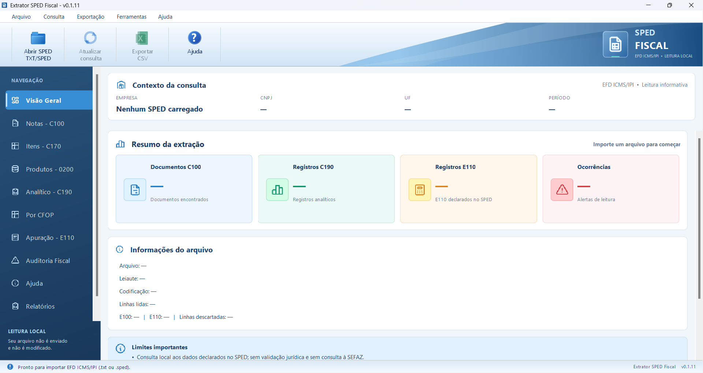

# Extrator SPED Fiscal — v0.1.11

Aplicativo desktop em **Java 8 e Swing** para explorar arquivos EFD ICMS/IPI localmente. Permite consultar documentos, produtos e itens e exportar os resultados sem modificar o TXT original.

## Interface



## Funcionalidades

- Consulta de documentos C100, analíticos C190, itens C170, produtos 0200 e apuração declarada E110.
- Filtros por documento, participante, produto, NCM, CFOP, CST e operação.
- Detalhamento de documentos com os analíticos e itens vinculados.
- Exportação das tabelas para CSV e XLSX, respeitando filtros e ordenação.
- Relatórios consolidados em PDF e XLSX com base nos registros C190.
- Catálogo de auditoria com diagnóstico de bases, CST e cadastro 0200, ocorrências de leitura e cópia fiel da EFD.
- Correção assistida RN07 de créditos de uso e consumo, com prévia, seleção manual, confirmação e relatório de auditoria.
- Ajuda integrada e offline, disponível também pela tecla F1.
- Processamento local, sem transmissão dos arquivos fiscais.

## Executar a partir do código

Requisito: **JDK 8 ou superior**. No PowerShell, na raiz do projeto:

```powershell
New-Item -ItemType Directory -Force build/classes | Out-Null
javac -encoding UTF-8 -source 8 -target 8 -d build/classes (Get-ChildItem src -Recurse -Filter *.java).FullName
Copy-Item resources/* build/classes -Recurse -Force
java -cp build/classes br.sig.sped.Main
```

Para gerar o JAR usado por `iniciar_extrator.bat`:

```powershell
jar cfm ExtratorSPED-v0.1.11.jar MANIFEST.MF -C build/classes .
```

Os arquivos `exemplo_sped_itens_ficticio.txt` e `exemplo_sped_ficticio.txt` são amostras fictícias para explorar o aplicativo.

## Testes de lógica e exportação

Após compilar, execute na raiz:

```powershell
java -cp build/classes br.sig.sped.SpedFunctionalTest exemplo_sped_ficticio.txt
java -cp build/classes br.sig.sped.DocumentoConsultaTest exemplo_sped_ficticio.txt
java -cp build/classes br.sig.sped.ItemConsultaTest exemplo_sped_itens_ficticio.txt
java -cp build/classes br.sig.sped.RelatorioExporterTest exemplo_sped_ficticio.txt build/test-output
java -cp build/classes br.sig.sped.TablerIconsTest
```

Há também testes visuais no diretório `src/br/sig/sped` que exigem ambiente gráfico.
Os testes `CreditoUsoConsumoTest`, `CorrecaoAvancadaTest` e `SpedFileIOTest` dependem de arquivos de ensaio específicos que não acompanham este repositório.

## Estrutura

| Pasta / arquivo | Conteúdo |
| --- | --- |
| `src/br/sig/sped/` | Código Java e testes |
| `resources/` | Ícones usados pelo aplicativo |
| `assets/tabler/` | Ícones de origem e licença de terceiros |
| `LEIA-ME.txt` | Instruções detalhadas da versão 0.1.11 |
| `CHANGELOG.txt` | Histórico da versão |

## Escopo

Ferramenta de consulta e apoio à revisão. A correção RN07 pode ajustar C170, C190, C100 e E110 em uma nova cópia, após revisão e confirmação manual. O piloto é restrito a MG, leiaute 020 e apuração simples, conforme os bloqueios descritos em `LEIA-ME.txt`. Não substitui PVA/SEFAZ nem faz validação fiscal oficial; o arquivo corrigido deve ser reimportado e validado no PVA. Os totais C100, C170, C190 e E110 têm bases distintas e não devem ser somados entre si.

Os binários da distribuição original não são versionados neste repositório; compile o código para executar. Os ícones Tabler mantêm a licença em `assets/tabler/LICENSE`.
